<p align="center">
  <picture>
    <source media="(prefers-color-scheme: dark)" srcset="apps/web/public/brand/stryveforms-logo-dark.svg">
    
  </picture>
</p>

<p align="center">
  <strong>The self-hosted, white-label form builder.</strong><br>
  Build forms, share or embed them, and collect answers — no submission limits, no paywalls, your infrastructure.
</p>

<p align="center">
  <a href="LICENSE"></a>
  
  <a href="#tech-stack"></a>
  <a href="CONTRIBUTING.md"></a>
</p>

<p align="center">
  <a href="#self-host-in-minutes">Self-host</a> ·
  <a href="CONTRIBUTING.md">Contributing</a> ·
  <a href="https://github.com/flyingwebie/stryveforms/discussions">Discussions</a>
</p>

<p align="center">
  <picture>
    <source media="(prefers-color-scheme: dark)" srcset=".github/assets/hero-dark.png">
    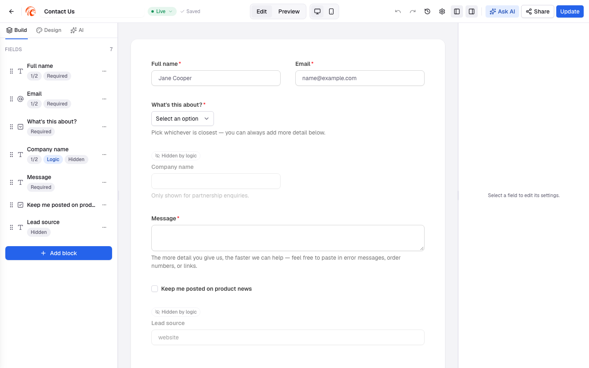
  </picture>
</p>

## Why StryveForms

Typeform-grade form building shouldn't require a monthly bill per seat, or trust in someone else's
server for every answer you collect. StryveForms is a complete, TypeScript rebuild of
[OpnForm](https://github.com/OpnForm/OpnForm) — same data model, so your existing forms migrate
over — built to be **self-hosted and white-labeled from the first screen**: your name, your logo,
your colours, running on infrastructure you control.

- **No limits, ever.** Unlimited forms, fields and submissions — it's your database.
- **White-label by default.** An instance looks like *your* product, not "StryveForms with a logo
  pasted on" — see Brand & white-label.
- **AGPL-3.0, forever.** No "enterprise" fork holding features back behind a paywall.
- **Built for AI agents too**, not just people — an MCP server and CLI ship in the box.

## Features

### A calm home for every form

<picture>
  <source media="(prefers-color-scheme: dark)" srcset=".github/assets/feature-forms-dark.png">
  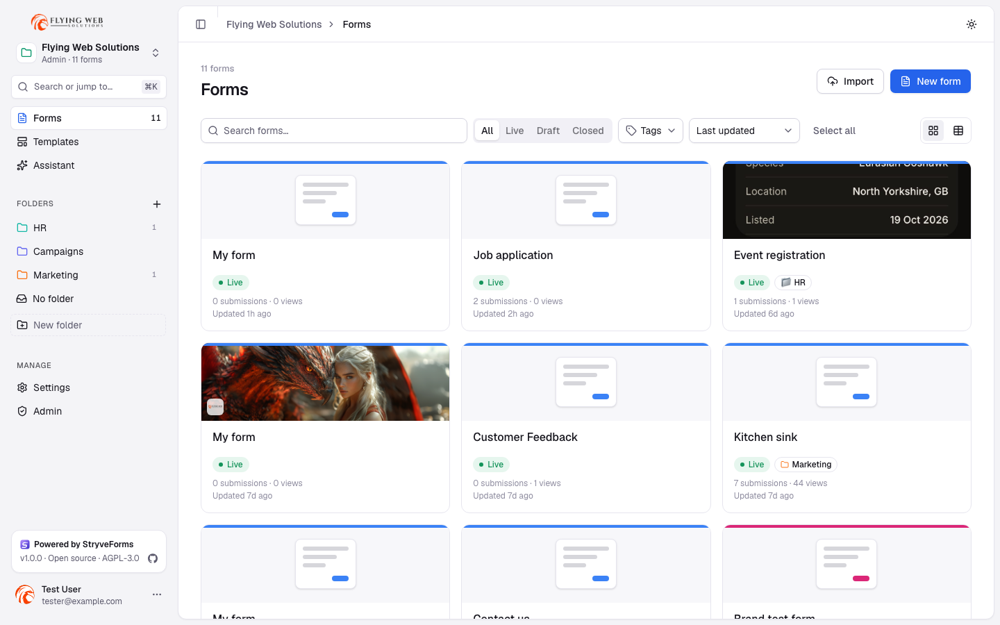
</picture>

Every form in a workspace at a glance: grid or table view, coloured folders (nested, drag-and-drop),
status filters (Live / Draft / Closed), tags, sorting and bulk actions. A **⌘K command palette**
jumps to any form, template, setting or workspace, and light, dark or system themes follow you
everywhere.

### Visual editor

<picture>
  <source media="(prefers-color-scheme: dark)" srcset=".github/assets/feature-editor-dark.png">
  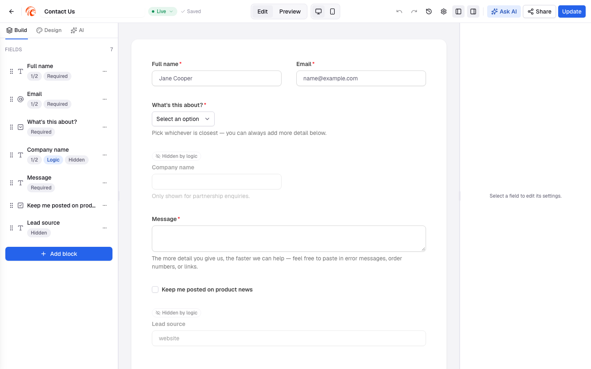
</picture>

Drag fields onto a live canvas from a library of 25+ block types (text, email, phone, rich text,
dates, dropdowns, choices, ratings, scales, matrices, file uploads, signatures, barcode/QR scanning,
media and layout blocks), resize them to sit side by side (full, ¾, ⅔, ½, ⅓, ¼), and reorder with
your mouse. Conditional logic (nested All/Any groups, ~40 operators), custom validation, computed
variables with 38 formula functions, and `@`-mention answers live in the field panel. Undo/redo,
version history with one-click restore, autosave and keyboard shortcuts included.

### Design that matches your brand

<picture>
  <source media="(prefers-color-scheme: dark)" srcset=".github/assets/feature-design-dark.png">
  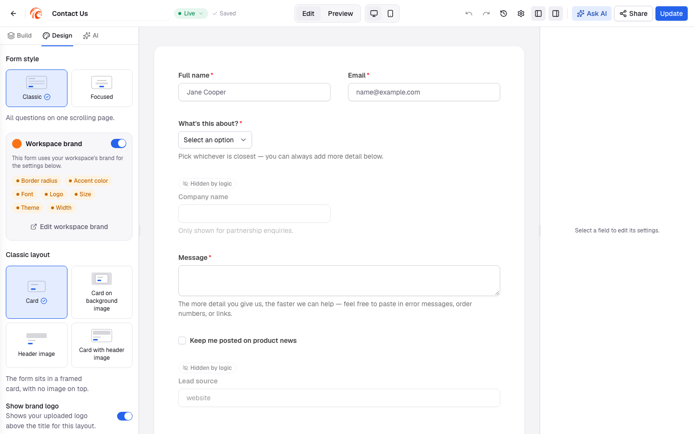
</picture>

Pick a theme, accent colour, font, size, corner radius and layout (card, card on background,
header image, card with header), add logos and background images from uploads or Unsplash, and
watch the form update live. Forms can follow the **workspace brand** — change it once in
Settings → Brand and apply it to every form.

### Classic or Focused

<picture>
  <source media="(prefers-color-scheme: dark)" srcset=".github/assets/feature-public-forms-dark.png">
  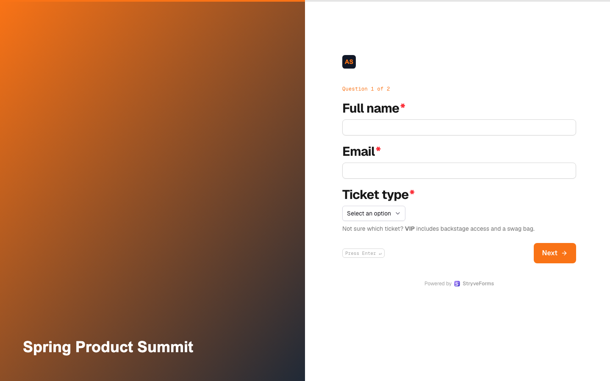
</picture>

Every form can present as **Classic** (every question laid out on the page, like a document) or
**Focused** (one question at a time, Typeform-style, with split, stacked or wallpaper images and
keyboard navigation). Either way: dark mode, right-to-left layouts, 30+ languages and custom CSS.
Password protection, closing dates, submission limits, captcha (hCaptcha, reCAPTCHA, Turnstile),
autosave, partial and editable submissions, confetti and redirects are all built in.

### Share anywhere

<picture>
  <source media="(prefers-color-scheme: dark)" srcset=".github/assets/feature-share-dark.png">
  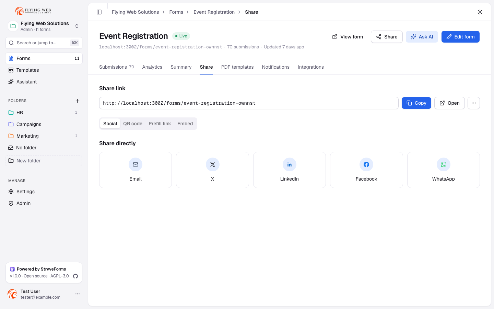
</picture>

Copy the link, post it to social networks, download a QR code (PNG or SVG), build prefilled links,
or embed the form as an auto-resizing iframe or a fully customisable popup launcher — with a live
preview and a copy-paste snippet.

### Submissions & analytics

<picture>
  <source media="(prefers-color-scheme: dark)" srcset=".github/assets/feature-submissions-dark.png">
  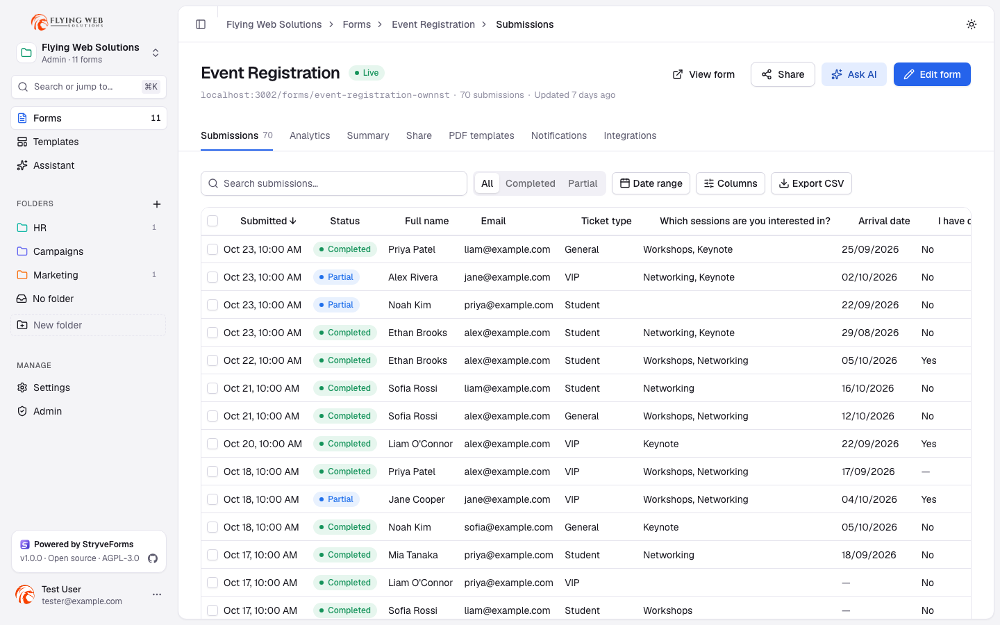
</picture>

Search, filter by status and date, choose and reorder columns, and export to CSV or PDF. Open any
submission to read, copy, print or edit the answers and see its full activity (edits and
integration deliveries). Built-in analytics track views, completion rate, average time, traffic
sources, countries and a per-question summary — no extra tool to wire up.

### Email notifications with live preview

<picture>
  <source media="(prefers-color-scheme: dark)" srcset=".github/assets/feature-notifications-dark.png">
  
</picture>

Design the notification email with a rich-text editor (TipTap), insert any field as an `@`-mention,
let AI draft the copy, add "only send if…" conditions and attach a PDF — and watch the live preview
re-render as you type, in light or dark. Send a real test to yourself before it goes near anyone
else. Runs on React Email + your own SMTP.

### Integrations & PDF templates

<picture>
  <source media="(prefers-color-scheme: dark)" srcset=".github/assets/feature-integrations-dark.png">
  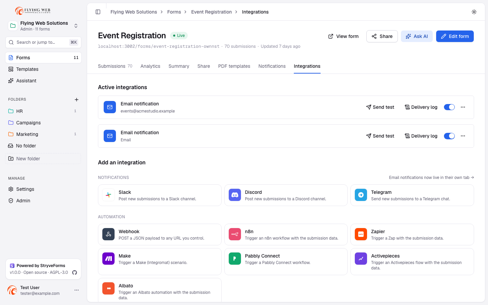
</picture>

Slack, Discord, Telegram, signed webhooks, n8n, Zapier, Make, Pabbly Connect, Activepieces and
Albato — each with conditions, a test button and a delivery log. Plus a visual PDF template editor:
upload your own PDF or start from scratch, place answer/text/image/QR/signature zones, and generate
a filled PDF for every submission.

### Templates

<picture>
  <source media="(prefers-color-scheme: dark)" srcset=".github/assets/feature-templates-dark.png">
  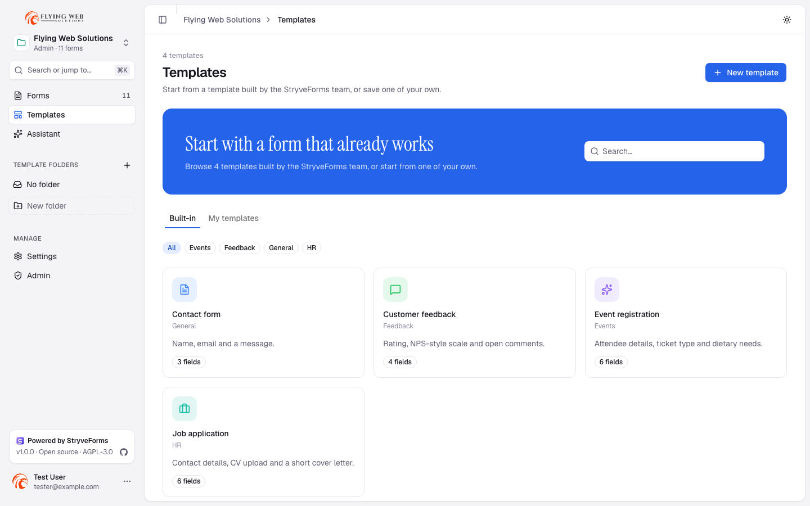
</picture>

Start from a built-in template or save any form as your own, organised in folders and categories,
with a live preview before you use it.

### Built for AI agents

<picture>
  <source media="(prefers-color-scheme: dark)" srcset=".github/assets/feature-ai-agents-dark.png">
  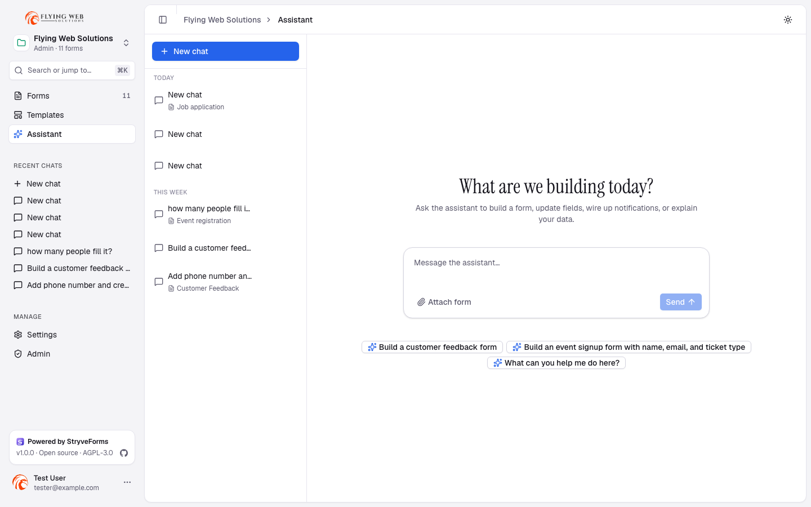
</picture>

The in-app assistant (bring your own OpenAI, Anthropic, Gemini, OpenRouter, OpenAI-compatible or
Ollama key) builds and edits forms from a plain description, sets up notifications and
integrations, or answers questions about a form's responses. The same actions are exposed over an
MCP server — so Claude Code, Cursor, VS Code/Copilot,
Codex or Windsurf can list, create, edit and publish forms, scoped to real workspace permissions —
and a scriptable `stryveforms` CLI for humans and CI.
Agent skills add task-specific instructions on top:

```bash
npx skills add flyingwebie/stryveforms
```

### Workspaces, brand and white-label

<picture>
  <source media="(prefers-color-scheme: dark)" srcset=".github/assets/feature-brand-dark.png">
  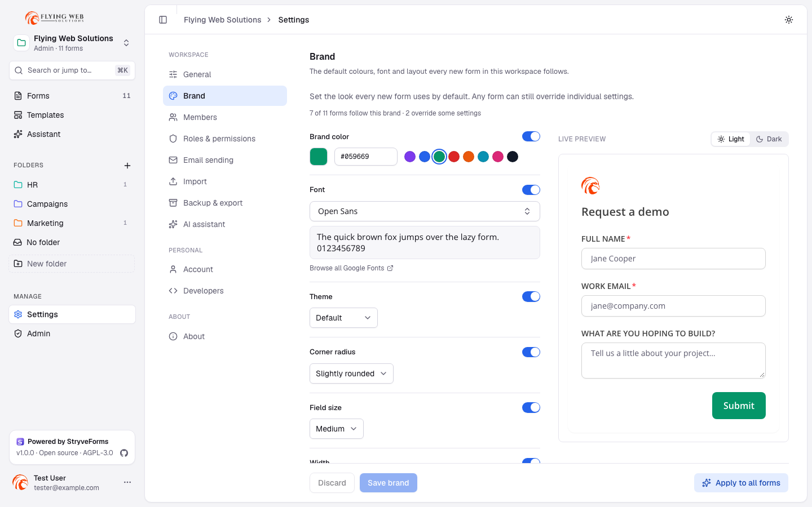
</picture>

Multiple workspaces with Admin / Member / Read-only roles and a per-capability permission matrix,
custom senders or SMTP, API tokens, passkeys and two-factor authentication. Instance admins set the
product name, logo, favicon, colours and email design, so the whole instance — sign-in page
included — looks like your product. Workspace export and scheduled backups (local or
S3-compatible) keep your data portable.

<picture>
  <source media="(prefers-color-scheme: dark)" srcset=".github/assets/feature-sign-in-dark.png">
  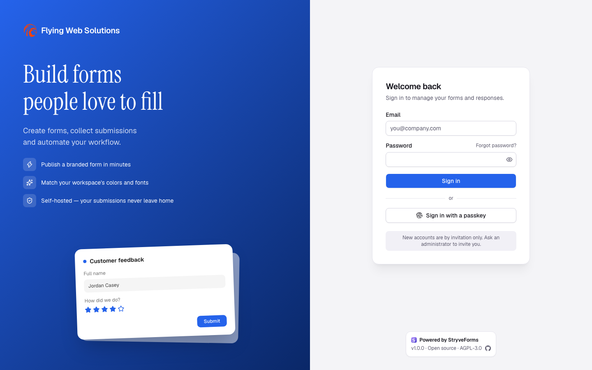
</picture>


## How it compares

An honest side-by-side with the tools StryveForms is most often compared to.
✅ yes · ◐ partly / paid plans only · — no, or we couldn't confirm it. Competitor columns reflect their
public pages and pricing as of October 2026; plans change, so check their sites before deciding.

| | **StryveForms** | **Jotform** | **Typeform** | **OpnForm** |
| --- | :---: | :---: | :---: | :---: |
| **Ownership & cost** | | | | |
| Open source | ✅ AGPL-3.0 | — | — | ✅ |
| Self-host on your own server | ✅ | — | — | ✅ |
| Free forever, no response caps | ✅ self-hosted | ◐ free plan: 5 forms, 100 submissions/mo | ◐ free plan: 10 responses/mo | ◐ self-hosted unlimited, free edition limited to 2 users |
| Unlimited users & workspaces | ✅ | ◐ per plan | ◐ per plan | ◐ paid license for more than 2 users |
| Remove vendor branding | ✅ free | ◐ paid plans | ◐ paid plans | ◐ paid license |
| White-label (your name, logo, colours, emails) | ✅ free | ◐ enterprise | ◐ higher plans | ◐ paid license |
| Your data stays on your infrastructure | ✅ | — | — | ✅ self-hosted |
| **Building forms** | | | | |
| Visual drag-and-drop editor | ✅ | ✅ | ✅ | ✅ |
| 25+ field types (matrix, rating, signature, file upload, barcode/QR) | ✅ | ✅ | ◐ | ✅ |
| Classic (whole page) **and** one-question-at-a-time styles | ✅ | ◐ | ◐ one-at-a-time focus | ◐ |
| Conditional logic, computed fields & formulas | ✅ | ✅ | ◐ | ✅ |
| Themes, custom fonts (Google Fonts), light/dark colours, custom CSS | ✅ | ✅ | ◐ | ◐ |
| Workspace brand applied to every form | ✅ | ◐ | ◐ | ◐ |
| Version history with restore | ✅ | ✅ | ◐ | — |
| Multi-page forms with progress bar | ✅ | ✅ | ✅ | ✅ |
| Password, closing date, submission limit, captcha | ✅ | ✅ | ◐ | ✅ |
| **Sharing** | | | | |
| Link, QR code, prefill links, iframe embed | ✅ | ✅ | ✅ | ✅ |
| Popup launcher embed | ✅ | ✅ | ✅ | ◐ |
| **Results & automation** | | | | |
| Submissions table, search, filters, CSV export | ✅ | ✅ | ✅ | ✅ |
| Edit submissions / let respondents edit | ✅ | ✅ | — | ✅ |
| Built-in analytics (views, completion, sources) | ✅ | ✅ | ✅ | ✅ |
| Rich email notifications with live preview | ✅ | ✅ | ◐ | ✅ |
| PDF generation with a visual template editor | ✅ | ✅ | — | — |
| Webhooks (signed), Slack, Discord, Telegram | ✅ | ✅ | ◐ | ✅ |
| n8n, Zapier, Make, Pabbly, Activepieces | ✅ | ✅ | ✅ | ✅ |
| Hundreds of native app integrations | — | ✅ | ✅ | — |
| Online payments | — not yet | ✅ | ✅ | ✅ |
| **AI** | | | | |
| AI assistant that builds and edits forms | ✅ bring your own key | ✅ | ✅ | ✅ |
| Choose your AI provider (OpenAI, Anthropic, Gemini, Ollama…) | ✅ | — | — | — |
| MCP server and CLI for AI agents | ✅ | — | — | — |
| **Team & admin** | | | | |
| Roles with a permission matrix | ✅ | ◐ | ◐ | ◐ |
| Passkeys and two-factor authentication | ✅ | ✅ | ✅ | ◐ |
| Workspace export/import and scheduled instance backups (S3) | ✅ | — | — | — |
| One-click import from OpnForm / JotForm | ✅ | — | — | — |
| **Maturity** | | | | |
| Template library | ◐ starter set | ✅ large | ✅ large | ◐ |
| Compliance certifications (HIPAA, SOC 2, GDPR tooling) | — you're in control, but not certified | ✅ | ✅ | ◐ |
| Official mobile apps | — responsive web | ✅ | — | — |

Where StryveForms is behind: online payments, the number of ready-made templates and native integrations,
and formal compliance certifications. Where it's ahead: price (free), ownership of your data, white-labelling,
the AI-agent tooling (MCP and CLI), and migration paths from the others.

Sources for the plan limits above: [Typeform pricing explained](https://tinycommand.com/blogs/typeform-pricing-explained),
[Jotform pricing 2026](https://www.activepieces.com/blog/jotform-pricing-2026-plans-costs-what-you-get.md) and
[OpnForm pricing](https://opnform.com/pricing).

## Self-host in minutes

StryveForms is three pieces: a **web** app (TanStack Start, public, port `3002`), a **server** API
(Hono + tRPC, private, port `3000`) and **PostgreSQL**. The web app proxies `/api` and `/trpc` to the
server, so only `web` needs a public domain.

**Docker Compose** (the fastest path on your own VPS):

```bash
git clone https://github.com/flyingwebie/stryveforms.git
cd stryveforms
docker compose up -d --build
```

See the self-hosting guide for every setting (S3
storage, SMTP, captcha, reverse proxies).

**Prebuilt images.** Every [release](https://github.com/flyingwebie/stryveforms/releases) publishes
multi-arch (amd64 + arm64) images to GitHub Container Registry, so you don't have to build anything:

```
ghcr.io/flyingwebie/stryveforms-web:1.0.0
ghcr.io/flyingwebie/stryveforms-server:1.0.0
```

[`docker-compose.coolify.yaml`](docker-compose.coolify.yaml) pulls them (set `STRYVEFORMS_VERSION`
to pin a release; it defaults to `latest`).

**One-click-ish platforms** — guides for each, including environment variables and volumes:

| Platform | Guide |
| --- | --- |
| Coolify (Docker Compose) | Coolify — Docker Compose |
| Coolify (Railpack) | Coolify — Railpack |
| Railway | Railway |
| Dokploy, CapRover, Render, Fly.io, plain VPS | Other platforms |

Start with the Deployment overview for the
architecture and the full environment-variable reference shared by every platform guide.

The first visit runs **onboarding**: create the administrator account, set your branding (name,
logo, colour), and choose whether people can sign up. Without `SMTP_HOST`, emails are printed to the
API server's log instead of sent.

## Migrate from OpnForm or JotForm

<picture>
  <source media="(prefers-color-scheme: dark)" srcset=".github/assets/feature-import-dark.png">
  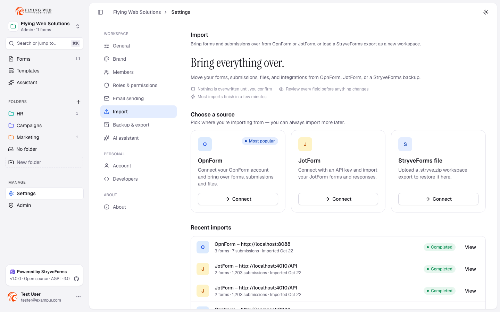
</picture>

Open **Settings → Import** and pick a source:

- **OpnForm** — create an access token (Settings → Access Tokens) with `forms-read`,
  `workspaces-read`, `workspace-users-read` and `manage-integrations`, then paste it (Cloud or your
  own self-hosted address). See Migrating from OpnForm.
- **JotForm** (US, EU, HIPAA, Enterprise) — create an API key (Settings → API, Read access) and
  paste it; the region is detected automatically. See Migrating from JotForm.
- **Another StryveForms instance** — upload a workspace export (`.stryve.zip`), enter its
  passphrase to bring secrets across (or skip them), and choose which members to invite.

Whichever source you pick, **Review import** shows exactly what will be created or updated — fields, submissions,
files, integrations — before anything starts, and it's safe to re-run without creating duplicates.

## Tech stack

| Part | Technology |
| --- | --- |
| Web app (`apps/web`) | React 19, TanStack Start/Router/Query, Tailwind v4, shadcn/ui (Base UI), TipTap |
| API (`apps/server`) | Bun, Hono, tRPC, Better Auth |
| Database (`packages/db`) | PostgreSQL, Drizzle ORM |
| Shared form logic (`packages/forms`) | Field catalogue, conditional logic, validation, mentions, formulas |
| Emails (`packages/emails`) | React Email + Nodemailer |
| Importers (`packages/opnform-import`, `packages/jotform-import`) | OpnForm and JotForm API clients and data mapping |
| API layer (`packages/api`) | tRPC routers, submission pipeline, integrations, storage (disk or S3) |

## Local development

Requirements: [Bun](https://bun.sh) 1.3+ and Docker (for a local PostgreSQL only).

```bash
git clone https://github.com/flyingwebie/stryveforms.git
cd stryveforms
bun install                                   # also generates typed env files via Varlock
cp apps/server/.env.example apps/server/.env  # edit BETTER_AUTH_SECRET at least
cp apps/web/.env.example apps/web/.env
bun run db:start                              # PostgreSQL in Docker
bun run db:push                               # create tables from the current schema
bun run dev                                   # http://localhost:3002 (API behind it on :3000)
```

| Command | What it does |
| --- | --- |
| `bun run dev` | Run web + server together |
| `bun run build` | Build all apps |
| `bun run check` | Lint + type-check the whole workspace |
| `bunx ultracite check` / `fix` | Lint and format ([Ultracite](https://ultracite.dev), zero-config Biome) |
| `bun test` (inside a package) | Unit tests — `packages/forms`, `packages/opnform-import`, `packages/jotform-import` |
| `bun run db:studio` | Drizzle Studio, a GUI for the local database |
| `bun run docker:up` | Build and start the full Docker Compose stack |

See [CONTRIBUTING.md](CONTRIBUTING.md) for the full repo map, coding standards and PR checklist.

## Roadmap

Nothing here is promised on a date — just where the project is headed:

- A localized UI (translations aren't wired up yet — see [CONTRIBUTING.md](CONTRIBUTING.md))
- More importers (Google Forms, Typeform) and more integration destinations
- A published `stryveforms` CLI package and prebuilt binaries

## Contributing

StryveForms is open source and welcomes contributions — code, docs, translations, bug reports. See
[CONTRIBUTING.md](CONTRIBUTING.md) for getting set up, coding standards, and where help is wanted,
and please read our [Code of Conduct](CODE_OF_CONDUCT.md). Found a security issue? See
[SECURITY.md](SECURITY.md) rather than filing a public issue.

## License

StryveForms is licensed under the [GNU AGPL v3](LICENSE) (see [NOTICE](NOTICE)). It is a TypeScript
rebuild of [OpnForm](https://github.com/OpnForm/OpnForm) and keeps OpnForm's data model, so existing
OpnForm forms, submissions, files and integrations migrate over with the built-in import tool.
